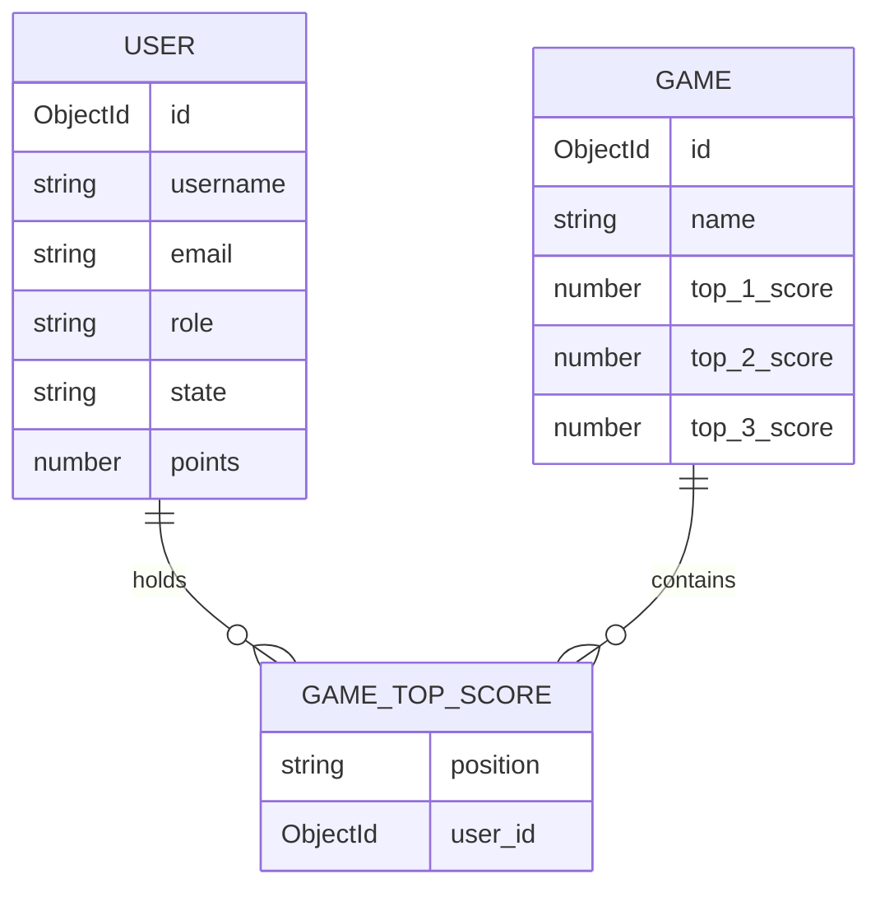

_This project has been created as part of the 42 curriculum by erde-la-, penpalac, jaferna2, ajodar-c, dfernan3._

# 42 ft_transcendence

## Table of Contents

- [Description](#description)
- [Team Information](#team-information)
- [Project Management](#project-management)
- [Technical Stack](#technical-stack)
- [Instructions](#instructions)
- [Features List](#features-list)
- [Database Schema](#database-schema)
- [Modules and Points](#modules-and-points)
- [Individual Contributions](#individual-contributions)
- [Resources and AI Usage](#resources-and-ai-usage)
- [Project Documentation](#project-documentation)
- [Development Commands](#development-commands)

## Description

### Project goal

**42 ft_transcendence** is a web application built as a collection of online mini-games. Authenticated users can access the lobby, interact with other players, join games, spectate ongoing matches, chat in real time, and use the available game and betting features.

The project is being developed as a real-time multiplayer experience. The initial product vision is to provide:

- A lobby for connected users.
- Real-time game rooms and synchronization between clients.
- Player and spectator experiences.
- User profiles, authentication, and account management.
- Social interaction through chat.
- Scores, game history, and a points-based economy.

The implementation and feature status are tracked in the sections below and
will be updated as features are completed and validated.

## Team Information


| Team member | Assigned role(s) | Responsibilities |
| --- | --- | --- |
| `erde-la-` | **Project Manager / Backend Developer** | Sprint planning and creation, task assignment, and backend development |
| `penpalac` | **Frontend Lead / Frontend Developer** | Design and implementation of the styling and frontend for the visible parts of the project |
| `jaferna2` | **Software Architect / Backend Developer** | Definition of the project structure and design patterns, implementation of those patterns, and backend development |
| `ajodar-c` | **Product Owner / Frontend Developer** | Decision-making, presenting and defending the project, and frontend development |
| `dfernan3` | **Full-Stack Developer** | Development of complementary backend and frontend features |

## Project Management

### Work organization

The team worked using a sprint-based process. At the beginning of each sprint,
the work was divided into small tasks and prioritized according to the current
needs of the project. Each task was assigned to a team member through GitHub
Projects and moved through the relevant status as work progressed.

Before starting a task, the assigned person moved it from **Ready** to
**In Progress** and assigned it to themselves. Completed work was reviewed by
the team before being integrated into the shared development branch. This
process helped us avoid duplicated work and keep track of each contribution.

The team's workflow was based on the following practices:

- Plan the sprint and select the features to be worked on.
- Divide each feature into small, manageable tasks.
- Assign tasks according to the team's responsibilities and current workload.
- Use feature branches for development.
- Review changes through commits, merges, and pull requests when appropriate.
- Test the feature before considering the task complete.
- Discuss blockers with the team and adjust the task assignment when needed.
- Review the progress made at the end of each sprint.

### Project management tools

- GitHub Projects: [team project board](https://github.com/users/eg-delacruz/projects/2).
- GitHub Issues and pull requests: feature tracking and code review.
- Git: version control and feature branches.
- Communication channels: Discord and WhatsApp.

### Branching model

- `origin/master` is the protected milestone and release branch.
- `origin/dev` is the integration branch for completed features.
- Feature branches should use the following naming convention: `feature/<area>/<feature-name>`, for example `feature/frontend/user-profile`.

## Technical Stack

| Area | Technology | Reason for the choice |
| --- | --- | --- |
| Frontend | React 19, TypeScript, Vite | Component-based UI and fast development feedback. |
| Frontend styling | Tailwind CSS | Reusable utility-based styling. |
| Frontend routing and i18n | React Router, i18next, react-i18next | Client-side navigation and translatable user-facing content. |
| Backend | Node.js, Express 5, TypeScript | HTTP API and server-side application logic. |
| Real time | Socket.IO, Redis adapter | Bidirectional events and synchronization between clients. |
| Database | MongoDB 6 with Mongoose | Document-oriented persistence for users, games, and related records. |
| Authentication | JSON Web Tokens, HTTP cookies, bcrypt | Session authentication and password protection. |
| API documentation | Swagger / OpenAPI | Interactive documentation for the backend API. |
| Runtime | Docker Compose | Reproducible frontend, backend, database, and Redis services. |
| Package manager | pnpm | The project enforces pnpm through package scripts. |

The stack is split into separate frontend and backend applications so that
each part can be developed and deployed independently. Redis is used to
support real-time services across backend processes, while MongoDB stores
persistent application data.

## Instructions

### Prerequisites

Install or make available:

- Docker Engine and Docker Compose.
- Git.
- `make` (the repository Makefile provides the development shortcuts).
- `pnpm` 10.x when running package commands manually.
- A modern browser with JavaScript enabled.

The normal development workflow runs the application services in Docker.
Do not use `npm` or `yarn` for this project.

### Configuration

Create a local environment file from the example:

```bash
cp .env.example .env
```

Review the values before starting the stack. The important settings include:

- `NODE_ENV`: development or production mode.
- `PORT`: backend port, normally `3000`.
- `MONGO_URI`: MongoDB connection string.
- `MONGO_ROOT_USER`, `MONGO_ROOT_PASS`, `MONGO_DB`: MongoDB initialization.
- `JWT_SECRET`: secret used to sign authentication tokens.
- `SUPER_EMAIL`, `SUPER_PASS`: credentials for the seeded super-admin account.

Never commit `.env` or real credentials. Use safe local values for development.

### Start the application

```bash
cd 42_ft_transcendence
cp .env.example .env
make up
```

Once the containers are ready:

- Frontend: <http://localhost:5173>
- Backend: <http://localhost:3000>
- Swagger UI: <http://localhost:3000/api-docs> (development only)
- MongoDB: `localhost:27017`

The backend health endpoint can be checked with:

```bash
curl http://localhost:3000/api/
```

The Docker Compose setup installs dependencies inside the corresponding
containers and starts the frontend and backend in development mode.

## Features List


| Feature | Status | Description | Contributors |
| --- | --- | --- | --- |
| Registration and login | Implemented; verify end-to-end | Create accounts and authenticate users. | `jaferna2`, `erde-la-`, `dfernan3` |
| Protected routes | Implemented; verify permissions | Restrict authenticated application views and API actions. | `jaferna2`, `erde-la-` |
| User profiles | Implemented; verify final flow | View and update user information, display name, and profile settings. | `penpalac`, `erde-la-`, `jaferna2` |
| Lobby and home | Implemented | Show the application entry point, game navigation, and connected-user experience. | `penpalac`, `dfernan3`, `ajodar-c` |
| Real-time chat | Implemented; verify reconnection | Send and receive messages through Socket.IO, including chat in game rooms. | `jaferna2`, `erde-la-`, `penpalac`, `dfernan3` |
| Mini-games | Implemented; verify complete matches | Play the available browser-based games, including The Race, Fight-Fight, and Deep Dark Dungeon. | `ajodar-c`, `penpalac`, `erde-la-` |
| Game rooms and synchronization | Implemented; verify multi-client behavior | Synchronize game state and player information between connected clients. | `dfernan3`, `jaferna2`, `penpalac`, `erde-la-` |
| Matchmaking | Implemented; verify full loop | Pair players and cycle through games using the real-time matchmaking flow. | `dfernan3`, `jaferna2`, `penpalac` |
| Spectator mode | Implemented / verify evaluation scenario | Observe an active match without playing, with real-time game-room updates and chat. | `penpalac`, `jaferna2`, `dfernan3` |
| Scores and match history | Partially implemented; verify persistence | Store and display game scores and top-score information. | `erde-la-`, `ajodar-c`, `penpalac` |
| Points and betting | Implemented; verify complete user flow | Use game points and betting-related UI/API features around matches. | `penpalac`, `erde-la-`, `ajodar-c` |
| Internationalization | Implemented; verify translation coverage | Support English, Spanish, and Portuguese translations through i18next. | `penpalac` |
| API documentation | Implemented | Publish the backend API through Swagger UI at `/api-docs`. | `erde-la-` |
| Public API | Implemented; verify external-client flow | Provide key-protected CRUD endpoints for game data with Swagger documentation and rate limiting. | `erde-la-` |
| Avatar/file uploads | Partially implemented; verify requirement scope | Provide avatar selection/storage and serve uploaded assets. | `penpalac`, `erde-la-` |


## Database Schema

The application uses MongoDB. The schema is represented by collections rather
than relational tables. The following is the initial domain model and must be
kept synchronized with the Mongoose models.

### Collections

| Collection | Purpose | Main relationships |
| --- | --- | --- |
| `users` | Credentials, profile data, roles, avatars, points, user state, and win/loss statistics. | Referenced by the top-score fields in `games`; real-time chat and socket authentication use user data. |
| `games` | One document per game type with its top three users and scores. | `top_1_user`, `top_2_user`, and `top_3_user` reference `users`. |

Chat messages and active socket sessions are currently handled as real-time
application data and are not represented by separate Mongoose collections.

### `users` fields

| Field | Type | Constraints or purpose |
| --- | --- | --- |
| `_id` | `ObjectId` | MongoDB document identifier. |
| `username` | `String` | Required, unique, and trimmed. |
| `email` | `String` | Required, unique, lowercased, and trimmed. |
| `password` | `String` | Required; stored as a hash. |
| `avatarUrl` | `String` | Default avatar path when no custom avatar is selected. |
| `avatar_url` | `String` | Additional avatar URL field used by the application. |
| `display_name` | `String` | Optional public display name. |
| `role` | `String` | Required; one of `user`, `admin`, or `super_admin`. |
| `state` | `String` | One of `offline`, `online`, `waiting`, `playing`, or `spectating`. |
| `points` | `Number` | Defaults to `100`; minimum value is `0`. |
| `stats.wins` | `Number` | Number of recorded wins; defaults to `0`. |
| `stats.losses` | `Number` | Number of recorded losses; defaults to `0`. |
| `createdAt` / `updatedAt` | `Date` | Automatically managed by Mongoose timestamps. |

### `games` fields

| Field | Type | Constraints or purpose |
| --- | --- | --- |
| `_id` | `ObjectId` | MongoDB document identifier. |
| `name` | `String` | Required and unique game name. |
| `top_1_user` / `top_2_user` / `top_3_user` | `ObjectId \| null` | Optional references to the `User` collection. |
| `top_1_score` / `top_2_score` / `top_3_score` | `Number` | Scores for the three stored leaderboard positions; default `0`. |
| `createdAt` / `updatedAt` | `Date` | Automatically managed by Mongoose timestamps. |

The current `Game` model stores leaderboard data by game type. It does not
yet represent every individual match as a separate persisted document, so
full match history should not be claimed until a dedicated match-history model
or equivalent persistence flow is implemented.

### Entity relationship diagram



## Modules and Points


### Chosen modules

| Module | Type | Points | Implementation summary |
| --- | --- | ---: | --- |
| Frontend and backend frameworks | Major | 2 | React with TypeScript is used for the frontend and Express with TypeScript for the backend. |
| Real-time features | Major | 2 | Socket.IO is used for real-time communication, including chat, game synchronization, matchmaking, and connection lifecycle handling. |
| Custom-made design system with at least 10 reusable components | Minor | 1 | The frontend follows a shared visual language based on reusable React components, Tailwind CSS utilities, consistent layouts, forms, buttons, navigation elements, game panels, chat panels, score displays, avatar controls, and responsive page sections. |
| Public API | Major | 2 | The backend exposes a documented `/api/public` namespace protected by an `x-api-key` header, scoped API keys, and rate limiting. It provides five database endpoints: `GET /api/public/games`, `GET /api/public/games/{game_name}`, `POST /api/public/games`, `PUT /api/public/games/{game_name}`, and `DELETE /api/public/games/{game_name}`. |
| Accessibility compliance | Major | 2 | The interface includes semantic labels, keyboard-accessible controls, image alternative text, and accessible interaction patterns. |
| Additional browser support | Minor | 1 | The application is intended to work in at least two browsers in addition to the main development browser. |
| Role-based user permissions | Major | 2 | Backend authentication and role middleware distinguish administrative and regular-user actions. |
| Complete web-based games | Major | 2 | The application contains browser-based mini-games with live matches and explicit game outcomes. |
| Remote players | Major | 2 | Two users can participate in the same game from separate clients through synchronized real-time game state. |
| More than one game with matchmaking | Major | 2 | The project includes multiple distinct mini-games, including The Race, Fight-Fight, and Deep Dark Dungeon, together with a real-time matchmaking flow for selecting players. |
| Spectator mode | Minor | 1 | Users can observe an active game in real time without being one of its players, with access to the game-room chat. |
| Support for multiple languages | Minor | 1 | There's at least 3 languages that can be selected by users. |

**Current claimed total: 20 points.**
The score is calculated as `2 points × Major modules + 1 point × Minor
modules`. Extra modules may be listed separately as bonus work only after the
mandatory target has been completed.

### Reusable frontend components

The project contains reusable components to maintain an cohesive style in all pages:

1. `arcadeform`: used for all form components to maintain the same aesthetic in login and register.
2. `customButton`: used for all buttons in the app.
3. `labelCustom`: used for all labels (both in forms and images).
4. `chatText`: used for messages, users and dates.
5. `credit-icon`: to keep the same style in all credit images.
6. `basicText`: used in minigames' texts.
7. `basicBox`: used in minigames to style divs.
8. `raceStatusBox`: to keep the same div style through the different race phases.
9. `raceRunner`: to make both users have the same style.
10. `animations`: diagonal, slideintop, vanish and appear are used throughout the web for different effects.

## Individual Contributions

This section must be updated throughout the project and should describe
specific, verifiable work rather than only listing a general area.

| Team member | Features and components | Modules |
| --- | --- | --- |
| `erde-la-` | Backend authentication and user-management endpoints; MongoDB/Mongoose models and seed data; game endpoints and score persistence; public API key management and rate limiting; Swagger/OpenAPI setup; Socket.IO backend support and chat services. | Backend and frontend frameworks; real-time features; role-based user permissions; public API; API documentation; scores and game data persistence. |
| `penpalac` | Frontend visual design and responsive layouts; reusable UI components; user profile and avatar interface; chat interface and game-room integration; mini-game UI and assets; i18next integration and English, Spanish, and Portuguese translations; accessibility improvements. | Accessibility compliance; additional browser support; custom-made design system; spectator mode; complete web-based games; internationalization candidate. |
| `jaferna2` | Authentication context and protected routes; login, registration, logout, and user flows; API and frontend utilities; initial Socket.IO chat and real-time game experiments; application structure and backend integration. | Frontend and backend frameworks; real-time features; remote players; role-based user permissions. |
| `ajodar-c` | Mini-game implementation and refactoring; game layouts, assets, and score integration; support for game-room experiences and player information. | Complete web-based games; remote players; second game with matchmaking; spectator mode. |
| `dfernan3` | Matchmaking implementation; Socket.IO game synchronization and `GameCanvas` initial sync; connection and authentication handling; complementary frontend/backend game features. | Real-time features; remote players; second game with matchmaking; spectator mode. |

## Resources and AI Usage

### Technical resources

- [42 ft_transcendence subject](./en.subject.pdf)
- [React documentation](https://react.dev/)
- [Vite documentation](https://vite.dev/guide/)
- [Express documentation](https://expressjs.com/)
- [Socket.IO documentation](https://socket.io/docs/v4/)
- [Mongoose documentation](https://mongoosejs.com/docs/)
- [MongoDB documentation](https://www.mongodb.com/docs/)
- [Docker Compose documentation](https://docs.docker.com/compose/)
- [pnpm documentation](https://pnpm.io/)

### AI usage

AI tools may be used to reduce repetitive work, but every generated result must be reviewed, understood, tested, and discussed with the team.

During the project, AI was used as an assistance tool throughout the
development lifecycle, including planning, implementation, debugging, testing,
code review, and documentation. It was used to explore implementation options,
understand framework APIs, suggest debugging approaches, improve error
messages, review the README against the subject requirements, and help design
manual test cases.

AI assistance was used across both the frontend and backend, including React
components, Express routes, Socket.IO flows, database documentation, and
project documentation. AI-generated suggestions were not accepted
automatically: the team reviewed the relevant source code, adapted suggestions
to the project, ran the applicable checks or tests, and kept only changes that
the team understood and could explain during evaluation.

| Project activity | AI assistance | Human validation |
| --- | --- | --- |
| Planning and architecture | Compare possible structures, workflows, and technical approaches. | The team selected the final approach according to the project requirements and existing codebase. |
| Frontend and backend development | Explain framework APIs, suggest implementation patterns, and help identify integration issues. | Developers reviewed, adapted, and tested every retained change. |
| Debugging and testing | Suggest likely causes, edge cases, and manual test scenarios for authentication, sockets, games, and matchmaking. | The team reproduced issues, ran the application, and verified the observed behavior. |
| Documentation | Organize the README, describe the database schema, review module requirements, and improve technical explanations. | The documentation was compared with the subject and the actual repository implementation. |
| Code review | Identify possible bugs, incomplete requirements, and inconsistent behavior. | Team members inspected the source code and decided which findings were relevant. |

AI did not replace peer review or technical responsibility. The final
implementation, tests, and documentation remain the responsibility of the
team.

## Development Commands

All commands are intended to be run from the repository root:

```bash
make up       # Build and start all services
make down     # Stop all services
make restart  # Restart services
make re       # Rebuild and restart services
make logs CONTAINER=backend
make logs CONTAINER=frontend
make logs CONTAINER=mongo
make backend   # Open a shell in the backend container
make frontend  # Open a shell in the frontend container
make mongosh   # Open a MongoDB shell
make status    # Show container status
make clean     # Clean dangling Docker resources
```

When adding a dependency, enter the relevant container first:

```bash
make backend
pnpm add <package-name>

make frontend
pnpm add <package-name>
```